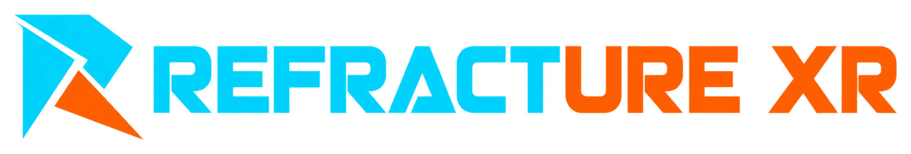

<p align="center"></p>

# Refracture XR

**An independent fork of Refract.** Based on Refract: https://github.com/MIXIDtheSilly/Refract

Refracture XR (Refracture for short) is a fork of [Refract](https://github.com/MIXIDtheSilly/Refract), which runs Meta Quest
(Android OpenXR) games on a Windows or Linux PC, in a PC VR headset or in a window on the screen.
Everything Refract does, Refracture does. Refracture adds one thing: **Unknown sources**, a way to run
Quest games that did not come from the Meta store.

Games run in one of three ways, exactly as in Refract:

- **Android Emulator** (Windows): the most compatible option.
- **Refract Native** (Windows, recommended): runs the game's ARM64 code directly on the PC.
- **Waydroid** (Linux): a container that shares the PC's kernel and GPU.

> **Status:** experimental. Not every game works yet, and Unknown sources is new (see
> [Limitations](#limitations)).

## What is different from Refract

| | Refract | Refracture |
| --- | --- | --- |
| Quest games you own on the Meta store | Connect Meta, download, install, play | Same |
| APKs you import by hand | Import APK (merged into your Meta library when it matches a game you own) | Same |
| Games from outside the Meta store | Only through Import APK, mixed in with the Library | **Unknown sources page**: its own list, no Meta sign-in, folder scan, expansion files, rebuild detection |

Unknown sources is built as separate modules, so Refracture can keep taking Refract's changes. The
files involved and the few lines they hook into are listed in [docs/unknown_sources.md](docs/unknown_sources.md).

## Unknown sources: for developers and ports

Unknown sources is for games the Meta store doesn't distribute:

- **Developers** testing a build before release, or after changes, without publishing it anywhere.
- **Official releases on itch.io** (or a developer's own site) that are not on the Meta store.
- **Ports** and community projects that their authors share freely.

On the **Unknown sources** page:

- **Add APK** picks an APK. Expansion files (`main.<n>.<package>.obb`, `patch.<n>.<package>.obb`) next to it,
  or in an `obb/<package>` folder beside it, come along.
- **Add folder** scans a folder (three levels deep) and adds every APK in it, the newest build of each
  game, with its expansion files.
- **Install / Update** installs the APK. It reads the APK again first, so a rebuilt version or launch
  activity is picked up, and saves are kept. A row shows **APK changed since install** when the file on
  disk is newer than the installed one: rebuild, then press Update.
- **Play / details** opens the normal game page: Play in VR, Play on PC, extra content files, open folder.
- **Pass the game's ownership check** is an off-by-default switch for your own builds that run a Meta
  entitlement check. Most itch.io and test builds don't have one and don't need it.
- The trash button removes the entry from Refracture. Your files and the installed copy are left alone.

Unknown-source games also show up in the main Library. A game whose package is already in your Meta
library is not taken over; use that game's own page for it.

## Limitations

- **Same compatibility as Refract.** Unknown-source games run on the same runtimes, so they hit the same
  limits: not every game works, 32-bit games don't run, older VrApi games are experimental, and
  mixed-reality games that need a room scan won't start. Being on Unknown sources doesn't make a game
  more likely to work.
- **A plain APK only.** App bundles and split APKs (`.xapk`, `.apks`, `.apkm`, split APK sets) are
  rejected. Extract them and add the game's base APK. Libraries and services with no launchable activity
  are rejected too.
- **You download the game yourself.** There is no itch.io (or other store) browsing, downloading or
  automatic updating. Download the build, then add it. Updates are a new APK plus **Update**.
- **Expansion files are matched by name.** Only `main.*` / `patch.*` OBBs carrying the game's package name
  are picked up automatically. Other content can be added from the game's page (**Add content files**).
  After adding content, install again to apply it.
- **The ownership switch is narrow.** It only makes Refract's Meta Platform stand-in answer a Meta
  entitlement check as passed. It does nothing for other stores' DRM, anti-tamper, or online services, and
  the player identity games see is Refract's per-install ID, not a Meta account.
- **Needs the Android SDK build tools and Python** (installed by **Settings > Setup**) to read an APK's
  package, version and launch activity.
- **No drag and drop yet.** Use Add APK or Add folder.
- **Source checkouts show Refract's name and logo.** Refracture XR's name, R mark and icons are applied when a
  release is built (see [Builds](#builds-and-branding)), so that merging Refract's changes never conflicts with
  them. Running from a source checkout gives the same features under Refract's branding. A source checkout is
  never offered updates; update it with git.
- **Releases lean on Refract's.** A Refracture XR package is Refract's own release with this launcher on top, so
  it can only be built on a Refract release that exists, and it moves with Refract's runtimes.
- **New and lightly tested.** The library logic has automated tests; it has not been tried against a wide
  range of real games or on every platform.

## Support

Refracture is built on Refract, and the hard part (the runtimes, the translator, the GPU and VR
plumbing) is the work of [Refract's author](https://github.com/MIXIDtheSilly/Refract), a student who builds
it in their spare time. If you'd like to see more Quest games running on PC, support goes to them:

[](https://ko-fi.com/mixid_mbb)

Starring the repo, trying it with your games and reporting what breaks helps too. Problems with Unknown
sources belong in this repository's issues; problems with the runtimes themselves are best checked
against upstream Refract first.

## Requirements

- Windows 10 or 11 (64-bit), or Linux with Waydroid 1.6.3 or newer
- A graphics card from the last few years
- 12 GB of RAM or more
- About 10 GB of free disk space, plus room for your games
- Virtualization turned on in the BIOS/UEFI (Windows)
- For VR: Meta Horizon Link (Quest Link / Air Link) or SteamVR; Monado or WiVRn also work on Linux.
  Without a headset you can play in a window.

## Getting started

### Windows

1. Download a package from this repository's **Releases** (unzip it somewhere permanent and open `Refract.exe`),
   if one has been published. Otherwise get a source checkout of this repository and double-click
   **Refract Launcher.cmd** (missing tools are installed for you; the first build takes a few minutes).
   Refract's own [releases](https://github.com/MIXIDtheSilly/Refract/releases) work too, but they do not
   include Unknown sources.
2. In **Settings > Setup**, click each button until everything is green.
3. Meta store games: **Connect Meta**, then download, install and play.
   Everything else: open **Unknown sources**, add the APK or folder, install and play.

### Linux

To build: CMake, Ninja, a C++20 compiler, the Android SDK and NDK, and a JDK.

```sh
./build_host.sh
ANDROID_ABI=arm64-v8a android-runtime-apk/build_apk.sh && platform-sdk/build_apk.sh
sudo scripts/waydroid.sh setup
waydroid session start
scripts/waydroid.sh install path/to/game.apk
scripts/waydroid.sh play com.example.game     # --headset for SteamVR/Monado/WiVRn
```

The launcher also runs on Linux, including Unknown sources. Details are in
[docs/linux_waydroid.md](docs/linux_waydroid.md).

## Builds and branding

Refract has no automated builds: its maintainer packages releases by hand on their own PC. Refracture XR adds two
GitHub Actions workflows (`.github/workflows/`):

Neither runs by itself: start them from the repository's **Actions** tab (**Run workflow**).

- **CI** runs the launcher's tests, builds the interface and compiles the Tauri shell, and fails if a merge from
  Refract changed a line the branding replaces.
- **Release** asks for Refracture XR's own version (`0.0.1`; nothing to do with Refract's), builds the launcher
  with Refracture XR's name, R mark, icons and that version on a throwaway copy, and lays it over Refract's newest
  packaged release for Windows and Linux. It creates a **draft** release for you to check and publish.

Because the branding is applied at build time, the files in this repository stay Refract's own and merging
Refract's changes stays easy. Details, and what to do when a merge breaks the branding, are in
[docs/refracture_builds.md](docs/refracture_builds.md).

## Staying in sync with Refract

```sh
git remote add upstream https://github.com/MIXIDtheSilly/Refract.git
git fetch upstream
git merge upstream/main        # use upstream's default branch name
```

Refracture keeps Refract's package names, file layout and data folder (`%APPDATA%\Refract`) on purpose, so
merges stay small and your library and saves carry over between the two.

## Not included

This repository contains no game APKs, Meta SDKs or Horizon OS files: bring your own games.
The Digitalis ARM64 translator (Apache-2.0) is included prebuilt in
[prebuilts/digitalis/](prebuilts/digitalis/).

Refracture is meant for apps you are allowed to run: games you own, your own builds, open samples, and
releases or ports that their authors distribute freely. Do not use it to bypass DRM, anti-cheat, platform
security, store restrictions or license terms, and do not use Unknown sources to run games you didn't get
legitimately.

## Credits and license

Refracture is a fork of [Refract](https://github.com/MIXIDtheSilly/Refract) by MIXID, which itself started as
a fork of [AXRB](https://github.com/Android-XR-Bridge/AXRB) by Feline Reintgen and has since grown well
beyond it. See [CREDITS.md](CREDITS.md).

Refracture is licensed under the **GNU GPL v3.0 or later** ([LICENSE](LICENSE)), with one additional
term ([NOTICE](NOTICE)): projects built on Refract must stay open source under GPL-3.0-or-later,
and must credit Refract with a visible link to <https://github.com/MIXIDtheSilly/Refract>. Code
still from AXRB is MIT-licensed; its notice is kept in [NOTICE](NOTICE).
